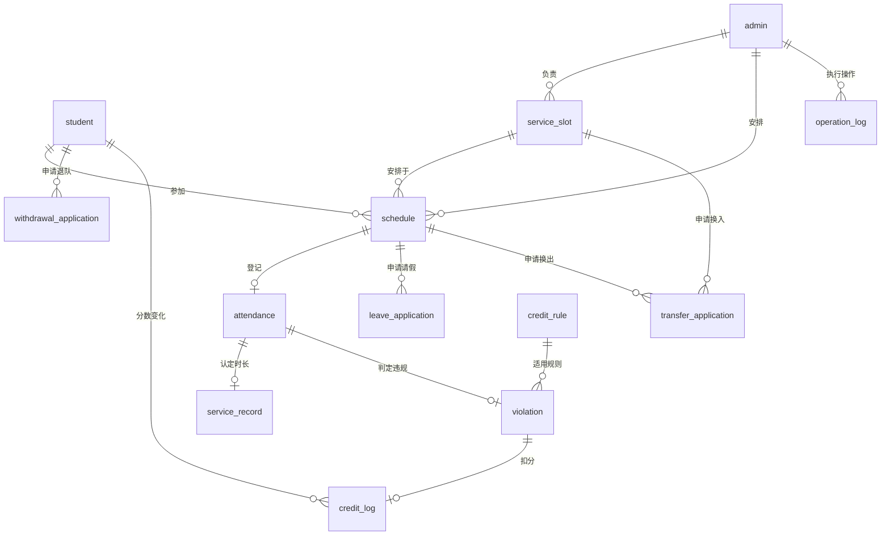

# 图书馆志愿服务数据库：实体与数据字典

本实现包含 **13 张核心表与 4 张扩展表**（共 17 张，扩展表由启动器迁移），SQL 设计兼容 MySQL 5.7.44 和 MySQL 8.0，使用 InnoDB、`utf8mb4` 字符集和 `utf8mb4_unicode_ci` 排序规则。本机可运行的版本为 5.7.44；MySQL 8.0 兼容性尚未在本机实例运行验证。先执行 `core/sql/schema.sql` 建表，再执行 `core/sql/constraints.sql` 安装验证触发器，最后才添加初始化数据。这两个文件不创建数据库，也不删除任何已有数据；数据库连接和初始化由配套程序处理。

MySQL 5.7 的 `CHECK` 子句不会实际执行校验，因此本实现统一通过 12 个 BEFORE INSERT/UPDATE 触发器，分别检查六张表的信用分、时段序号、时间顺序、容量、服务分钟数、规则版本、扣分幅度和流水算式；触发器使用 `SIGNAL SQLSTATE '45000'` 拒绝非法写入。MySQL 命令行客户端可直接识别 `DELIMITER $$`，连接库需按配套初始化脚本解析分隔符。版本行为依据 [MySQL 官方 5.7 参考手册的 CREATE TABLE、CREATE TRIGGER 和 SIGNAL 章节](https://downloads.mysql.com/docs/refman-5.7-en.pdf)。

## 1. 已确认的业务规则

- 新志愿者初始信用分为 5 分。迟到扣 2 分，缺勤扣 3 分，信用分最低为 0。
- 信用分降至 0 时，停用志愿者并取消其尚未开始的未来排班，保留历史记录。
- 正常出勤和迟到都计该班次完整服务时长：第 3 时段为 180 分钟，其余时段为 120 分钟。迟到另外扣信用分。
- 获批请假不计时、不扣分；缺勤不计时。
- 换班可选择其他日期，必须检查目标班次人数和学生的时间冲突。初审通过后仍需超级管理员终审，最终通过时才执行排班变更。
- 一个服务班次指定一名负责的普通管理员；管理员角色、状态及操作权限由业务层检查。

容量以“日期＋班次”为单位计算，服务班次定义本身可在不同日期复用。跨日期换班不等于跨午夜班次；当前班次要求同一天内结束时间晚于开始时间。

## 2. 实体和联系

| 表名 | 实体/业务记录 | 一行的含义 | 主键 |
|---|---|---|---|
| `student` | 志愿者 | 一名志愿者 | `student_id` |
| `admin` | 管理员 | 一名普通管理员或超级管理员 | `admin_id` |
| `service_slot` | 服务班次 | 可复用的班次设置 | `slot_id` |
| `schedule` | 排班 | 某学生在某日参加某班次 | `schedule_id` |
| `attendance` | 考勤 | 对一次排班的最终出勤登记 | `attendance_id` |
| `service_record` | 服务时长记录 | 一次考勤认定的服务分钟数 | `record_id` |
| `leave_application` | 请假申请 | 针对某次排班的请假申请 | `leave_id` |
| `transfer_application` | 换班申请 | 原排班换至目标日期和班次的申请 | `transfer_id` |
| `withdrawal_application` | 退队申请 | 一名志愿者的退队申请 | `withdrawal_id` |
| `credit_rule` | 信用规则 | 一类违规的某个规则版本 | `rule_id` |
| `violation` | 违规记录 | 一次考勤对应的违规事件 | `violation_id` |
| `credit_log` | 信用流水 | 一次违规实际引起的扣分 | `credit_log_id` |
| `operation_log` | 操作日志 | 一次管理员操作及修改前后值 | `log_id` |

图中省略了申请审批人、考勤登记人、规则创建人等重复的管理员连线；以以下字段定义和建表脚本为准。`0..1` 表示最多一条，并不表示数据库会自动创建这条记录。

## 3. 通用约定

- 所有数字编号都是 `BIGINT UNSIGNED AUTO_INCREMENT`；学生编号是 `VARCHAR(32)`，可保留学号前导零。
- 除表格标注“可空”外，字段均为 `NOT NULL`。
- 时间戳为 `DATETIME(6)`，创建类时间默认 `CURRENT_TIMESTAMP(6)`。应用和 MySQL 应统一使用学校所在地时间（本项目为北京时间）；字段本身不保存时区。
- 密码字段保存加盐密码哈希，不能保存明文密码。账号唯一约束不等于密码安全机制。
- 所有外键均使用 `ON DELETE RESTRICT ON UPDATE RESTRICT`。采用状态变更保留历史，不级联删除考勤、时长或信用记录。
- `active_marker` 是数据库自动计算的生成列，应用不可手工写入。利用 MySQL 唯一索引允许多条 `NULL` 的特性，限制有效记录，同时保留已取消或已拒绝的申请历史。

## 4. 逐表字段

### 4.1 `student`：志愿者

| 字段 | 类型/约束 | 含义 |
|---|---|---|
| `student_id` | VARCHAR(32)，PK | 学号或志愿者编号 |
| `name` | VARCHAR(100) | 姓名 |
| `college` | VARCHAR(100)，可空 | 学院 |
| `phone` | VARCHAR(32)，可空 | 联系方式 |
| `password_hash` | VARCHAR(255) | 登录密码哈希 |
| `credit_score` | INT，默认 5，触发器校验 ≥ 0 | 当前信用分 |
| `status` | ENUM，默认 ACTIVE | ACTIVE 在队可参与；QUIT 已退队；DISABLED 已停用 |
| `join_time` | DATETIME(6) | 加入时间 |

保留当前信用分便于准入检查；`credit_log` 保存变更来源。当前分数与流水的同步依赖事务，不由外键自动完成。

### 4.2 `admin`：管理员

| 字段 | 类型/约束 | 含义 |
|---|---|---|
| `admin_id` | BIGINT UNSIGNED，PK、自增 | 管理员编号 |
| `name` | VARCHAR(100) | 姓名 |
| `account` | VARCHAR(64)，UNIQUE | 登录账号 |
| `password_hash` | VARCHAR(255) | 登录密码哈希 |
| `role` | ENUM，默认 NORMAL | NORMAL 普通管理员；SUPER 超级管理员 |
| `status` | ENUM，默认 ACTIVE | ACTIVE 启用；DISABLED 停用 |

### 4.3 `service_slot`：服务班次

| 字段 | 类型/约束 | 含义 |
|---|---|---|
| `slot_id` | BIGINT UNSIGNED，PK、自增 | 班次编号 |
| `team_name` | VARCHAR(100) | 分队名称 |
| `period_no` | INT，触发器校验 > 0 | 时段序号 |
| `start_time` | TIME | 开始时间 |
| `end_time` | TIME，触发器校验 > start_time | 结束时间 |
| `location` | VARCHAR(200) | 服务地点 |
| `need_num` | INT，触发器校验 > 0 | 每日期该班次的容量 |
| `service_minutes` | INT，触发器校验 > 0 | 班次标准认定时长（分钟） |
| `manager_admin_id` | FK → admin.admin_id | 班次负责管理员 |
| `status` | ENUM，默认 ACTIVE | ACTIVE 启用；DISABLED 停用 |

班次的实际起止时间用于冲突判断，`service_minutes` 用于认定服务时长，两者含义不同。业务层按第 3 时段 180 分钟、其余 120 分钟设置；SQL 的正值约束本身不会推出这一规则。

### 4.4 `schedule`：排班

| 字段 | 类型/约束 | 含义 |
|---|---|---|
| `schedule_id` | BIGINT UNSIGNED，PK、自增 | 排班编号 |
| `student_id` | FK → student.student_id | 参加学生 |
| `slot_id` | FK → service_slot.slot_id | 服务班次 |
| `admin_id` | FK → admin.admin_id | 排班操作管理员 |
| `schedule_date` | DATE | 服务日期 |
| `status` | ENUM，默认 ACTIVE | ACTIVE 有效待执行；CANCELLED 已取消；COMPLETED 已完成考勤登记 |
| `create_time` | DATETIME(6) | 创建时间 |
| `active_marker` | TINYINT，生成列，可空 | ACTIVE/COMPLETED 为 1，CANCELLED 为 NULL |

`UNIQUE(student_id, slot_id, schedule_date, active_marker)` 防止同人同日同班次出现多个有效或已完成排班；取消后可以重新安排，并保留旧排班。已完成排班也受保护，避免重复登记时长。

额外的 `UNIQUE(schedule_id, student_id)` 为申请表的复合外键提供被引用键，保证申请人就是排班中的学生。索引覆盖学生日期、班次日期和全局日期查询。

### 4.5 `attendance`：考勤

| 字段 | 类型/约束 | 含义 |
|---|---|---|
| `attendance_id` | BIGINT UNSIGNED，PK、自增 | 考勤编号 |
| `schedule_id` | UNIQUE，FK → schedule.schedule_id | 对应排班，一次排班最多登记一条最终考勤 |
| `admin_id` | FK → admin.admin_id | 考勤登记管理员 |
| `attendance_status` | ENUM | NORMAL 正常；LATE 迟到；ABSENT 缺勤；LEAVE 请假 |
| `check_time` | DATETIME(6) | 登记时间，不等同于实际刷卡到场时间 |
| `remark` | VARCHAR(1000)，可空 | 备注 |

学生、日期及班次通过 `schedule_id` 查询，不在本表重复保存。本版本按一次最终考勤建模，未建立多次签到/签退明细。

### 4.6 `service_record`：服务时长

| 字段 | 类型/约束 | 含义 |
|---|---|---|
| `record_id` | BIGINT UNSIGNED，PK、自增 | 时长记录编号 |
| `attendance_id` | UNIQUE，FK → attendance.attendance_id | 计时依据，一次考勤最多产生一条记录 |
| `service_minutes` | INT，触发器校验 ≥ 0 | 最终认定分钟数；历史快照 |
| `record_status` | ENUM，默认 VALID | VALID 有效；VOID 作废 |
| `create_time` | DATETIME(6) | 创建时间 |

汇总时只累加 VALID 记录，并用总分钟数除以 60 显示小时。采用整数分钟避免小数小时计算误差。`service_record → attendance → schedule` 可查到学生和服务日期；不重复存储这些字段。

### 4.7 `leave_application`：请假申请

| 字段 | 类型/约束 | 含义 |
|---|---|---|
| `leave_id` | BIGINT UNSIGNED，PK、自增 | 请假申请编号 |
| `student_id` | FK → student.student_id | 申请学生 |
| `schedule_id` | 与 student_id 共同 FK → schedule(schedule_id, student_id) | 要请假的排班，并强制学生一致 |
| `reason` | VARCHAR(1000) | 申请原因 |
| `apply_time` | DATETIME(6) | 申请时间 |
| `approve_admin_id` | 可空，FK → admin.admin_id | 实际审批人 |
| `approve_status` | ENUM，默认 PENDING | PENDING 待审；APPROVED 通过；REJECTED 拒绝；CANCELLED 取消 |
| `approve_time` | DATETIME(6)，可空 | 审批时间 |
| `active_marker` | 生成列，可空 | 待审/已通过为 1，其他为 NULL |

`UNIQUE(schedule_id, active_marker)` 限制同一次排班最多有一条待审或已通过的请假。请假覆盖整次排班，不另外保存局部请假时间区间。

### 4.8 `transfer_application`：跨日期换班申请

| 字段 | 类型/约束 | 含义 |
|---|---|---|
| `transfer_id` | BIGINT UNSIGNED，PK、自增 | 换班申请编号 |
| `student_id` | FK → student.student_id | 申请学生 |
| `old_schedule_id` | 与 student_id 共同 FK → schedule(schedule_id, student_id) | 原排班 |
| `new_slot_id` | FK → service_slot.slot_id | 目标班次 |
| `new_date` | DATE | 目标服务日期，支持跨日 |
| `reason` | VARCHAR(1000) | 申请原因 |
| `apply_time` | DATETIME(6) | 申请时间 |
| `first_admin_id` | 可空，FK → admin.admin_id | 初审人 |
| `first_status` | ENUM，默认 PENDING | PENDING、APPROVED、REJECTED |
| `first_time` | DATETIME(6)，可空 | 初审时间 |
| `final_admin_id` | 可空，FK → admin.admin_id | 终审人 |
| `final_status` | ENUM，默认 PENDING | PENDING、APPROVED、REJECTED、CANCELLED |
| `final_time` | DATETIME(6)，可空 | 终审时间 |
| `new_schedule_id` | 可空，与 student_id 共同 FK → schedule(schedule_id, student_id) | 成功换班后创建的新排班 |
| `active_marker` | 生成列，可空 | 初审未拒绝且终审待审为 1，其余为 NULL |

`UNIQUE(old_schedule_id, active_marker)` 防止同一原排班同时挂多份待处理换班申请。终审前目标名额未被预约，因此终审时必须重新检查容量和冲突，不能只依赖提交申请时的检查。初审、终审状态顺序以及终审人的角色由业务层校验。

### 4.9 `withdrawal_application`：退队申请

| 字段 | 类型/约束 | 含义 |
|---|---|---|
| `withdrawal_id` | BIGINT UNSIGNED，PK、自增 | 申请编号 |
| `student_id` | FK → student.student_id | 申请学生 |
| `reason` | VARCHAR(1000) | 退队原因 |
| `apply_time` | DATETIME(6) | 申请时间 |
| `admin_id` | 可空，FK → admin.admin_id | 审批管理员 |
| `approve_status` | ENUM，默认 PENDING | PENDING、APPROVED、REJECTED |
| `approve_time` | DATETIME(6)，可空 | 审批时间 |
| `active_marker` | 生成列，可空 | 待审为 1，其余为 NULL |

`UNIQUE(student_id, active_marker)` 限制每个学生只有一份待审退队申请。获批后将学生状态改为 QUIT，并取消未来排班；历史记录保留。

### 4.10 `credit_rule`：版本化信用规则

| 字段 | 类型/约束 | 含义 |
|---|---|---|
| `rule_id` | BIGINT UNSIGNED，PK、自增 | 规则编号 |
| `violation_type` | ENUM | LATE 迟到；ABSENT 缺勤 |
| `version` | INT，触发器校验 > 0 | 对该违规类型的规则版本 |
| `deduct_score` | INT，触发器校验 ≥ 0 | 规则规定的扣分幅度，使用正数 |
| `status` | ENUM，默认 ACTIVE | ACTIVE 启用；RETIRED 历史版本 |
| `create_admin_id` | FK → admin.admin_id | 规则创建者 |
| `create_time` | DATETIME(6) | 创建时间 |
| `active_marker` | 生成列，可空 | 启用为 1，历史为 NULL |

`UNIQUE(violation_type, version)` 防止版本重复；`UNIQUE(violation_type, active_marker)` 保证每类违规最多一个当前规则。更新规则时退役旧版本并新增版本，不能覆盖历史规则。首次初始化应创建迟到扣 2 分、缺勤扣 3 分两项规则。

### 4.11 `violation`：违规事件

| 字段 | 类型/约束 | 含义 |
|---|---|---|
| `violation_id` | BIGINT UNSIGNED，PK、自增 | 违规编号 |
| `attendance_id` | FK → attendance.attendance_id | 相关考勤，可保留多次撤销历史，最多一个有效违规 |
| `rule_id` | FK → credit_rule.rule_id | 采用的规则版本 |
| `nominal_deduct` | INT，触发器校验 ≥ 0 | 当时规则规定的扣分幅度快照 |
| `status` | ENUM，默认 VALID | VALID 有效；REVOKED 已撤销 |
| `create_time` | DATETIME(6) | 记录时间 |

通过考勤关联学生，避免维护两份学生编号。`nominal_deduct` 表示规则标准，实际扣分可能因为信用分最低为 0 而更少。

### 4.12 `credit_log`：信用变动流水

| 字段 | 类型/约束 | 含义 |
|---|---|---|
| `credit_log_id` | BIGINT UNSIGNED，PK、自增 | 流水编号 |
| `student_id` | FK → student.student_id | 信用发生变化的学生 |
| `violation_id` | 可空，与 rule_id 共同 FK → violation(violation_id, rule_id) | 对应违规，扣分及冲正引用它，手动调分为空 |
| `rule_id` | 可空，FK → credit_rule.rule_id，另参与上述复合外键 | 所依据的规则版本，手动调分为空 |
| `operator_id` | FK → admin.admin_id | 触发本次考勤/扣分的管理员 |
| `change_score` | INT | 实际变动量，扣分为负数 |
| `before_score` | INT，触发器校验 ≥ 0 | 变动前分数 |
| `after_score` | INT，触发器校验 ≥ 0 | 变动后分数 |
| `change_reason` | VARCHAR(1000) | 变动原因 |
| `change_time` | DATETIME(6) | 变动时间 |

数据库校验 `after_score = before_score + change_score`。例如原来只有 1 分，缺勤标准扣 3 分，则 `nominal_deduct=3`，流水为 `before_score=1, change_score=-1, after_score=0`，不能记成 -2 分。

`entry_type` 区分扣分、冲正和超管调分。`reverses_log_id` 为可空唯一自外键，使原扣分最多被冲正一次。改判将旧违规标记 REVOKED 并追加信用流水，具体升级字段见文末。

### 4.13 `operation_log`：操作审计

| 字段 | 类型/约束 | 含义 |
|---|---|---|
| `log_id` | BIGINT UNSIGNED，PK、自增 | 日志编号 |
| `admin_id` | FK → admin.admin_id | 操作管理员 |
| `operation_type` | VARCHAR(64) | 操作类型 |
| `target_table` | VARCHAR(64) | 操作目标表名 |
| `target_id` | VARCHAR(64) | 操作目标记录编号，兼容字符串学号 |
| `before_value` | JSON，可空 | 修改前快照 |
| `after_value` | JSON，可空 | 修改后快照 |
| `reason` | VARCHAR(1000) | 操作原因或说明 |
| `operation_time` | DATETIME(6) | 操作时间 |

`target_id` 并非外键，因为它随 `target_table` 指向不同表。目标真实性由写入日志的业务操作保证。日志不应包含密码明文或密码哈希。

## 5. 数据库约束与业务事务的分工

数据库已经提供外键、非负值触发器、一对一唯一约束、有效申请去重和规则版本唯一性。以下跨行或跨表规则必须由服务层在同一事务中实现，单独运行建表 SQL 不会自动执行它们：

1. **排班容量与时间冲突。** 检查学生和班次有效状态，锁定相关学生、班次后检查同日名额和其他班次。时间段 A、B 在同一天且 `A.start < B.end AND A.end > B.start` 才冲突；首尾相接不冲突。
2. **考勤、计时、扣分一致提交。** 一次考勤登记同时完成排班状态变更、应有时长记录、违规、实际扣分流水和学生分数更新；中途失败整体回滚。
3. **信用分归零处理。** 停用学生并取消其尚未开始的未来排班，必要时终止这些排班上的待处理申请；保留已经发生的服务和扣分记录。
4. **长期换时段。** 终审重新检查固定归属、目标容量和冲突，保存归属生效时间并更新未来安排；不允许单次跨日期换班。
5. **审批权限及状态流转。** 外键只保证管理员存在，不保证角色、所负责班次、是否已停用，也不强制初审在终审之前。
6. **规则调整与敏感修改留痕。** 修改规则采用新增版本；修改服务时长需权限和原因，并将修改前后值与业务更新一同写入事务。

申请中的学生和排班一致性有复合外键保障。`credit_log(violation_id, rule_id)` 的复合外键进一步强制流水所用规则与违规规则一致。流水中的学生与违规所属学生一致，则由本期的考勤扣分事务构造并检查；独立的学生外键本身不保证这一点。

## 6. 相对 PPT 的落地调整

- 每次排班只登记一条最终考勤；每条考勤最多对应一条时长记录、一个有效违规，撤销的违规历史保留。唯一约束防止重复。
- 考勤不冗余学生编号；时长不冗余学生、排班和日期；违规不冗余学生。查询时通过外键 JOIN 获取，减少不一致数据。
- 用整数分钟存时长，用班次标准时长和服务记录历史时长分别表达当前规则与实际认定结果。
- 换班补充 `new_date`、`new_schedule_id`，完整表达跨日期目标和变更结果。
- 班次增加负责管理员，普通管理员的管理范围据此检查；本版本不另建权限表或管理员班次关联表。
- 信用规则增加版本；违规保存标准扣分，信用流水记录实际扣分，清楚表达 0 分下限。
- 登录增加密码哈希字段，审计快照使用 JSON。保留原规划的 13 张核心表，并通过迁移增加 4 张扩展表。

## 2026-09-27 学期升级

完整结构须通过启动器迁移，当前共 17 张表。下列升级说明覆盖上方原始 13 张表的旧快照。

- `semester`：学期名称、开工日期、结束周次及日期、配置管理员、排班提示和最近自动结算时间。
- `semester_day`：以 `(semester_id, service_date)` 为主键，保存逐日日历模式、执行星期、说明和人工覆盖标记。
- `schedule.semester_id`：可空外键，引用 `semester`；空值表示学期计划外的历史或手动记录。`week_no` 为开工所在自然周起算的周次。`cancel_reason=MANUAL` 阻止同步时恢复手动取消的排班，`SYNC` 表示日历或固定归属调整取消。
- `attendance.source`：`MANUAL` 或 `AUTO_WEEKLY`。系统自动结算以学期配置管理员为审计关联人，操作类型明确标示自动行为。
- `transfer_application`：仅 `old_slot_id` 的长期申请可继续提交和审批；旧日期字段保留历史兼容。

规则与接口见 [学期排班使用说明](学期排班使用说明.md)。

## 2026-09-27 补计与考勤改判升级

- `semester.members_initialized`：初始名单是否已经落定。`semester_member` 保存学期、队员、固定时段及 `effective_from / effective_until`；生成列约束同一学期、学生、时段最多一条未结束归属。
- `student.credit_version` 用于避免基于旧页面覆盖新分数；`disabled_by_credit` 区分信用归零停用与其他停用。
- `attendance.revision` 为改判版本；`source=CORRECTED` 标记人工改判。每个排班仍只有一条考勤，历次变更写入操作日志。
- `violation` 保留被撤销的记录，取消原 attendance_id 单列唯一约束，改用 `(attendance_id, active_marker)` 保证每条考勤最多一条 VALID 违规，允许多个 REVOKED 历史。
- `credit_log.entry_type` 为 DEDUCTION、REVERSAL、MANUAL_SET。违规和规则外键允许空值用于手动调分；扣分和冲正仍关联原违规与规则。原单违规单流水约束改为普通索引。
- `credit_log.reverses_log_id` 自引用原扣分流水并唯一，确保一个扣分只被冲正一次。返还实际扣分，不使用名义扣分；信用流水只追加。
- `schedule.cancel_reason` 增加 CREDIT、QUIT。信用恢复只恢复因 CREDIT 取消、尚未开始且当前归属有效的安排，手动取消和历史保留。
- 考勤改判同步恢复或作废服务时长。审计记录保存改判前考勤、分数、时长和请假信息；数据库命名锁和事务同时保护改判、调分及周结算。

## 2026-09-27 管理员关联升级

`admin.student_id` 为可空的 VARCHAR(32)，唯一外键引用 student.student_id。一个队员最多对应一个管理员身份，独立管理员为空；表数量仍为 17。关联管理员按队员当前密码验证，关联队员停用／退队后暂停权限。负责人仍使用 service_slot.manager_admin_id；授权不改变 slot_member。`PROMOTE_STUDENT` 审计记录保存负责时段变更和原因，密码不进入接口响应或审计。
